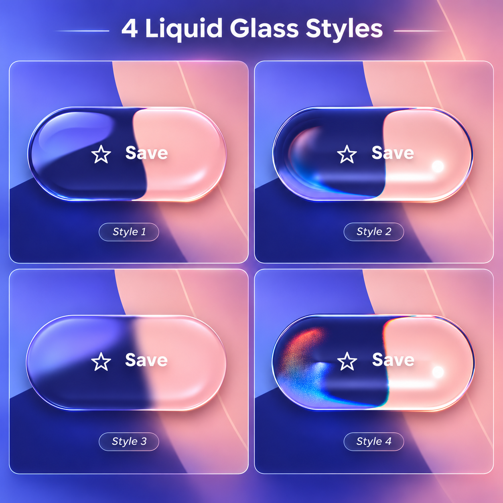

# Glass in Motion

## Glass in Motion — Showcase



### Liquid Glass in Action

https://github.com/user-attachments/assets/df14bbcb-21b4-4188-9028-1a64013996b5

**A live, interactive control studio for real WebGL liquid-glass effects.**

[**Try the live demo**](https://ademxg.github.io/glass-in-motion/) · [**View the source**](https://github.com/ademxg/glass-in-motion)

Glass in Motion combines the open-source [`ybouane/liquidglass`](https://github.com/ybouane/liquidglass) rendering engine with a custom visual playground. Adjust optical properties, tune the surface, experiment with presets, and move an animated wallpaper behind the refracting elements — all in real time.

> **Project scope:** This repository provides an interactive playground and UI built around an existing open-source glass engine. It is **not** presented as an independently invented refraction renderer or a separate drop-in glass library.

## Preview

Open the [live interactive demo](https://ademxg.github.io/glass-in-motion/). Desktop and mobile screenshots are included in the release ZIP under `assets/`.

## Features

- **Real WebGL refraction:** uses the bundled liquidglass shader, including optical refraction, blur, chromatic aberration, and specular lighting where supported.
- **Four presets:** Original glass, Clear crystal, Soft lens, and Prismatic.
- **Live optical controls:** tune refraction, chromatic aberration, lens blur, distortion, and Fresnel reflection.
- **Surface controls:** corner radius, glass thickness, edge highlights, specular lighting, shadows, opacity, tint, brightness, and saturation.
- **Two lens geometries:** biconvex pill and magnifying dome.
- **Animated background:** drag to reposition the wallpaper, zoom it, shift its colors, or pause/resume motion.
- **Exportable settings:** copy configuration as JSON or save a `.json` file.
- **Responsive design:** desktop control panel and touch-friendly mobile layout.
- **Fallback:** a CSS appearance when WebGL initialization is unavailable; advanced refraction requires browser GPU support.

## Getting started

**Option 1: open the single HTML file**

1. Download `index.html` from this repository.
2. Open it with Chrome, Edge, Safari, or Firefox. For a mobile device, open it as a **webpage** in a browser, not a text/code viewer.
3. Drag the background behind the glass, select a preset, and adjust the sliders.

**Option 2: run a local web server**

```bash
python -m http.server 8000
```

Then open `http://localhost:8000`.

No framework build or package installation is needed for the bundled standalone HTML demo.

## Using the controls

1. Choose a preset under **Look presets** to establish a starting appearance.
2. Adjust **Optics** for how light bends, blurs, and splits.
3. Adjust **Surface** for depth, corners, lighting, and tint.
4. Use **Wallpaper** to move the background behind the glass.
5. Choose **Copy config** or **JSON** to preserve your settings. **Reset** restores the original settings.

**Note:** The glass engine is a bundled derivative of the upstream project; the studio controls target this version of the engine. A JSON export is intended as a record of settings, not a promise of compatibility with other libraries or versions.

## Publishing on GitHub Pages

Place `index.html` in the root of your GitHub repository. In **Settings → Pages**, select **Deploy from a branch → main → /(root)**. Once deployed, the demo will be served from:

https://ademxg.github.io/glass-in-motion/

If the live link still shows an earlier version, ensure you replaced the repository's root `index.html` and check the latest GitHub Pages workflow run.

## Open source and credit

**Glass in Motion studio, customization, and interface:** maintained at [`ademxg/glass-in-motion`](https://github.com/ademxg/glass-in-motion).

**Original glass rendering engine:** [`ybouane/liquidglass`](https://github.com/ybouane/liquidglass). The WebGL rendering and shader implementation originate from that project and are bundled into the standalone HTML. The upstream project identifies its license as MIT.

**Bundled third-party dependency:** [`bubkoo/html-to-image`](https://github.com/bubkoo/html-to-image), also distributed under MIT.

This project does **not** claim authorship of the original rendering engine or bundled dependency. See [THIRD_PARTY_NOTICES.md](THIRD_PARTY_NOTICES.md) for license and attribution information, and [LICENSE](LICENSE) for this repository's own MIT license.

## Contributions

Bug reports, accessibility improvements, documentation fixes, optimization work, and well-tested UI improvements are welcome via GitHub Issues and Pull Requests. Please describe the change, explain how you tested it, and attach before/after screenshots for visual changes. Respect upstream licenses and preserve their attribution when redistributing bundled code.

## Known limitations

WebGL behavior and graphics performance depend on device/browser support. Some browsers or security settings may display the CSS fallback. The project is an experimental demonstration and is not yet a supported reusable component package.
